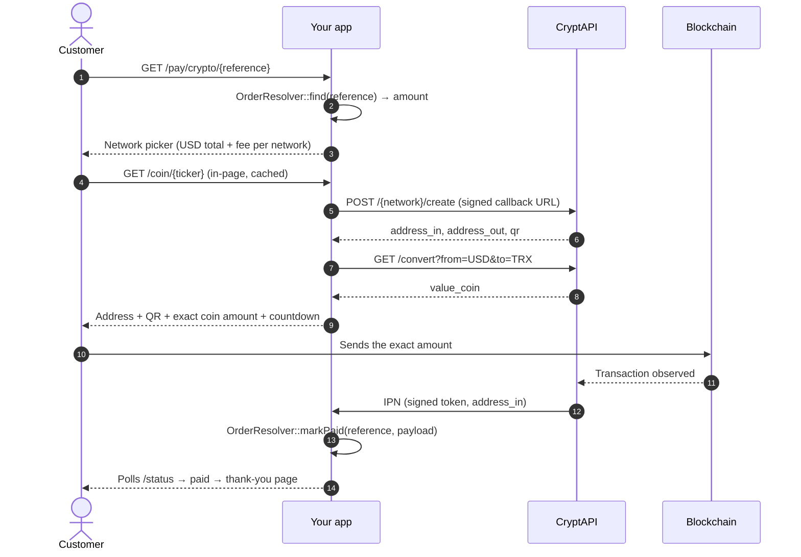

# cryptapi-checkout

**Self-hosted crypto checkout for Laravel.** Your customers stay on your domain, pick a network, pay the exact amount in that coin, and the order is confirmed by CryptAPI's IPN **and** by an independent on-chain transaction check.

[](https://github.com/devmgh1992/cryptapi-checkout/tags)
[](https://www.php.net)
[](https://laravel.com)
[](tests)
[](LICENSE)

---

## Why this package

Most crypto gateways hand the customer to a third-party page you cannot style, cannot translate and cannot audit. This package keeps the whole flow inside your application:

- **No hosted redirect.** `/pay/crypto/{reference}` is yours: your domain, your fonts, your brand.
- **The amount is in the coin, not in dollars.** `61.3046 TRX`, not `$18.99`. The conversion comes from CryptAPI's `/convert/` endpoint, and the network fee is applied before the conversion.
- **Instant network switching.** Tapping another network swaps the address, QR code and amount in place, with no reload. Repeated taps are served from a client-side cache and issue no request at all.
- **A hard payment window.** Every checkout has a 30-minute clock (configurable). When it closes, the payment is cancelled, the address stops being monitored, and the customer can start a fresh window with one click.
- **A submitted TXID is never trusted.** Before anything is activated, the package reads the chain and checks the destination wallet, the amount, the confirmations, the block time, replays and self-transfers.
- **Your order model stays yours.** One small `OrderResolver` class is the only integration point — no `orders`/`invoices` schema is imposed.

## Requirements

| Requirement | Version |
|---|---|
| PHP | 8.1 or newer |
| Laravel | 10.x, 11.x, 12.x |
| CryptAPI | account with your domain whitelisted (no API key required) |
| Payout wallet | one address per network you enable |

## Installation

```bash
composer config repositories.cryptapi-checkout vcs https://github.com/devmgh1992/cryptapi-checkout
composer require devmgh1992/cryptapi-checkout
php artisan vendor:publish --tag=cryptapi-checkout-config
php artisan migrate
```

Register your wallets in `config/cryptapi-checkout.php`, implement the resolver, then link to the checkout:

```php
return redirect()->route('cryptapi-checkout.show', $order->order_number);
```

The full walkthrough — including a working resolver — is in **[docs/installation.md](docs/installation.md)**.

## How a payment flows



If the IPN never arrives, the customer can paste the TXID. That path is verified against the chain, not against the browser (see **[docs/security.md](docs/security.md)**).

## Configuration at a glance

```php
// config/cryptapi-checkout.php
'prefix'         => 'pay/crypto',              // route prefix
'window_minutes' => 30,                        // payment window
'order_resolver' => App\Support\CryptoOrderResolver::class,
'thanks_url'     => '/order/{reference}/thanks',
'brand'          => ['name' => env('APP_NAME')],
'demo_address'   => null,                      // set to skip CryptAPI in local tests

'coins' => [
    [
        'ticker'  => 'trc20_usdt',             // network_token, or a bare ticker for native coins
        'name'    => 'USDT',
        'network' => 'TRON (TRC20)',
        'group'   => 'usdt',                   // usdt | network | token — controls grouping in the picker
        'address' => env('CRYPTO_USDT_TRC20'),
        'fee_pct' => 5,                        // added on top, for this network only
        'enabled' => true,
    ],
],
```

Every key, environment variable and default is documented in **[docs/configuration.md](docs/configuration.md)**.

## Supported networks

| Family | Networks | Address creation | TXID verification |
|---|---|---|---|
| Tron | TRX, USDT-TRC20 | CryptAPI | TronGrid |
| EVM | BNB, BEP20 tokens, POL, Polygon tokens, ETH/ERC20, Base, Arbitrum, Optimism, Avalanche C-Chain | CryptAPI | Public JSON-RPC |
| Solana | SOL, USDT-SOL, USDC-SOL | CryptAPI | Solana JSON-RPC |
| Other | BTC, LTC, BCH, XMR, … | CryptAPI | Manual review |

Any coin CryptAPI can issue an address for works out of the box. Automatic TXID verification covers the networks in the table above; anything else is stored as `confirming` for manual review and is **never** auto-activated. See **[docs/networks.md](docs/networks.md)**.

## Security model

| Threat | Control |
|---|---|
| Forged IPN | HMAC-SHA256 token per reference **and** per coin; a token for one coin cannot confirm another |
| IPN for someone else's address | `address_in` must belong to a payment issued for that reference |
| Fake TXID | Destination wallet, amount (1% drift tolerance), confirmations, block time and status are read from the chain |
| Replay of a real TXID | A TXID already used on another paid reference is rejected and logged |
| Self-transfer | Transactions sent from your own payout wallet are rejected |
| Brute force | 6 TXID submissions per 10 minutes per reference |
| Stale address after expiry | Late claims are refused; the customer is offered a new window instead |
| Cache poisoning | The checkout page is served `no-store`; nothing is accepted from client input |

Details and a hardening checklist: **[docs/security.md](docs/security.md)**.

## HTTP interface

| Method | URI | Name | Purpose |
|---|---|---|---|
| GET | `/pay/crypto/{reference}` | `cryptapi-checkout.show` | Picker or payment panel |
| GET | `/pay/crypto/{reference}/coin/{ticker}` | `cryptapi-checkout.coin` | JSON payload for in-page switching |
| GET | `/pay/crypto/{reference}/status` | `cryptapi-checkout.status` | Polling endpoint |
| POST | `/pay/crypto/{reference}/txid` | `cryptapi-checkout.txid` | Manual TXID submission |
| POST | `/pay/crypto/{reference}/renew` | `cryptapi-checkout.renew` | Start a fresh window |
| GET | `/pay/crypto/callback/{reference}/{token}` | `cryptapi-checkout.callback` | CryptAPI IPN |

Payloads, status codes and the IPN specification: **[docs/api.md](docs/api.md)**.

## Events

```php
use Nous\CryptApiCheckout\Events\CryptoPaymentConfirmed;
use Nous\CryptApiCheckout\Events\CryptoPaymentExpired;

Event::listen(CryptoPaymentConfirmed::class, function (CryptoPaymentConfirmed $event) {
    // $event->payment  — the CryptoPayment row
    // $event->data     — reference, coin, txid, usd, coin_amount, confirmations, verified[]
});
```

`OrderResolver::markPaid()` is called at the same moment, so you can choose events, the resolver, or both.

## Scheduling

The package registers `cryptapi:expire` on Laravel's scheduler. It expires payments whose window closed and fires `CryptoPaymentExpired`:

```cron
* * * * * cd /path/to/app && php artisan schedule:run >> /dev/null 2>&1
```

Expiry is also enforced lazily on every page view and status poll, so a missing cron cannot leave an address alive forever.

## Local development and testing

```dotenv
CRYPTO_CHECKOUT_DEMO_ADDRESS=TYourTronWallet
```

With `demo_address` set, no request is sent to CryptAPI — every network hands out that address, so the entire UI can be exercised offline. TXID verification still talks to the real chain, which makes it safe to test against a real (small) transaction on a testnet-free network such as Tron.

```bash
composer install
vendor/bin/phpunit
```

## Documentation

| Document | Contents |
|---|---|
| [docs/installation.md](docs/installation.md) | Step-by-step setup with a complete resolver |
| [docs/configuration.md](docs/configuration.md) | Every config key and environment variable |
| [docs/integration.md](docs/integration.md) | Order model patterns, provisioning hooks, idempotency |
| [docs/security.md](docs/security.md) | Threat model, verification matrix, hardening checklist |
| [docs/networks.md](docs/networks.md) | Supported chains, tokens, decimals, RPC endpoints |
| [docs/api.md](docs/api.md) | JSON endpoints and IPN specification |
| [docs/troubleshooting.md](docs/troubleshooting.md) | Symptoms, causes, fixes |
| [CHANGELOG.md](CHANGELOG.md) | Release history |

## Contributing

Bug reports and pull requests are welcome — see **[CONTRIBUTING.md](CONTRIBUTING.md)**. Security issues should follow **[SECURITY.md](SECURITY.md)** instead of the public issue tracker.

## License

Released under the [MIT License](LICENSE).
